# 🎴 Master Duel Studio

《游戏王 Master Duel》的本地修改工具。召唤动画、发动特效、超框卡图、大厅壁纸，一个 WinUI 3 程序全部搞定，**每一张卡的改动都能单独复原**，生成完还能在软件里先播一遍再决定要不要写进游戏。

> 仅支持 PC 版（Steam），Windows 10 1809 及以上。
> 常规改动写入你自己的账号数据目录；替换大厅背景时会写入游戏的 `data.unity3d`，写入前会自动留一份原图。

---

## 📋 目录

- [功能一览](#-功能一览)
- [界面预览](#-界面预览)
- [视频教程](#-视频教程)
- [页面详解](#-页面详解)
- [使用须知](#-使用须知)
- [常见问题](#-常见问题)
- [构建](#-构建)
- [致谢](#-致谢)

---

## ✨ 功能一览

| 功能 | 做什么 | 写到哪里 |
|---|---|---|
| 🖼 **超框卡图** | 把卡面做成超框：主体跨出卡框，五种边框效果可选 | 账号目录 |
| 🎞 **召唤动画** | 素材可来自视频 / GIF / 帧序列（自动去背）或 Spine 骨架。视频导入会把来源卡那套结构整体克隆过来；Spine 导入是原地换骨架与贴图 | 账号目录 |
| 💥 **卡牌特效** | 发动特效：借用游戏里现成的一套，或用视频自制，可换音效。播融合召唤演出的特殊卡不在其列 | 账号目录 |
| 👀 **预览** | 生成完在软件里按真实时长播一遍，动画与特效各留一份缓存，写完再看不满意可以重来 | 不写游戏文件 |
| 🌄 **壁纸** | 大厅壁纸与大厅背景替换 | 账号目录 + `data.unity3d` |
| 📦 **分享** | 把做过的卡按卡打包给别人，或安装别人的整合包 | 按包内容决定 |
| 🕘 **历史** | 按卡记录三类改动与每一次复原，附操作日志 | — |
| ⚙️ **设置** | 游戏目录、账号切换、备注名、预演开关、预览缓存清理、游戏更新后重新同步 | — |
| 🧪 **预演** | 只走流程不写文件，本次运行有效 | — |

---

## 📸 界面预览

<table>
  <tr>
    <td align="center">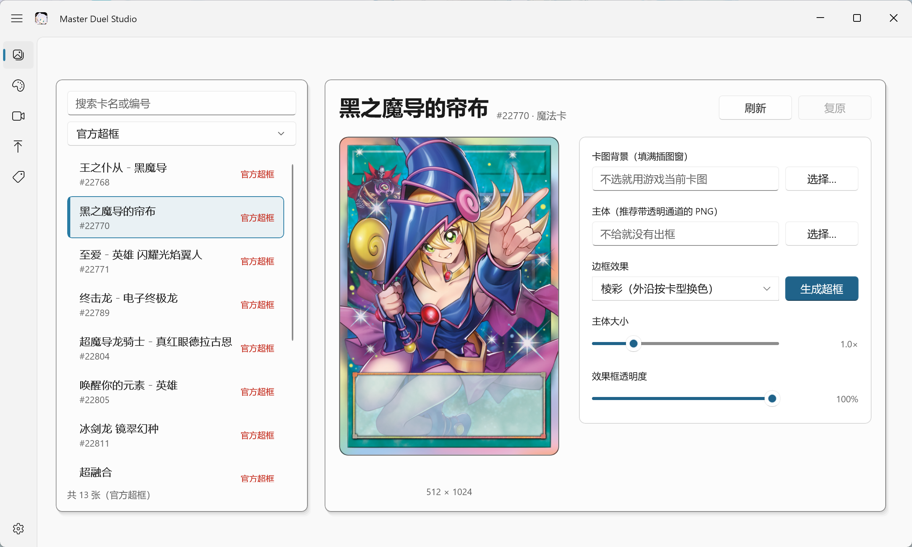<br><b>超框卡图</b></td>
    <td align="center">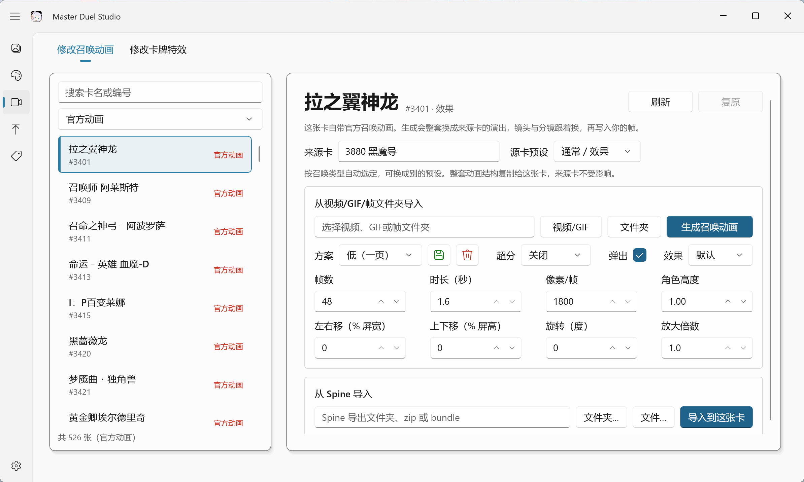<br><b>召唤动画</b></td>
  </tr>
  <tr>
    <td align="center">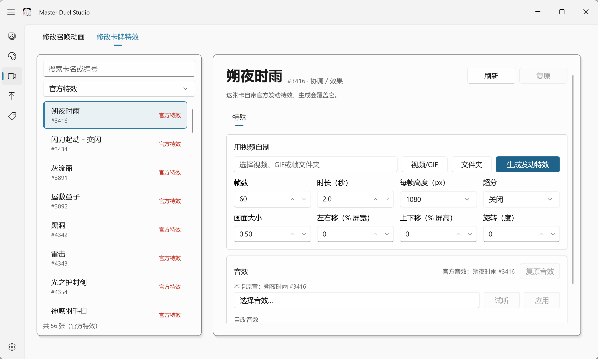<br><b>卡牌特效</b></td>
    <td align="center">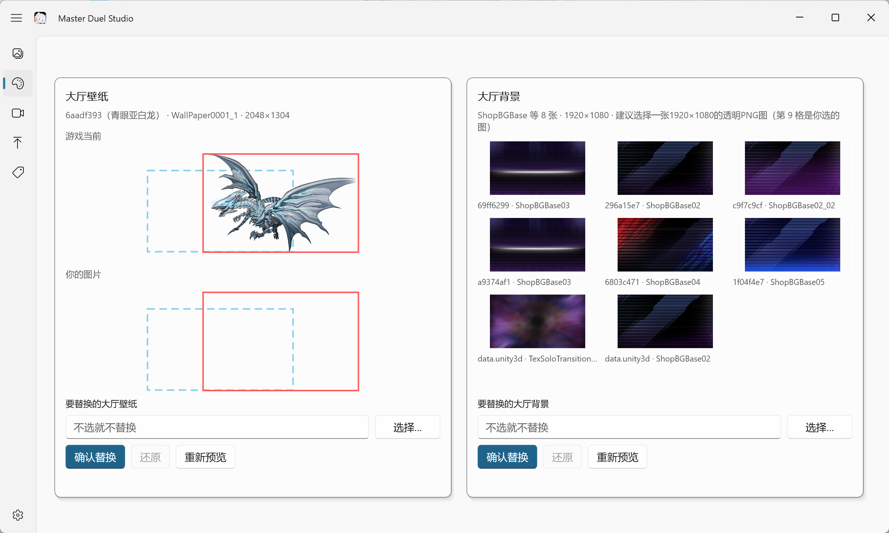<br><b>大厅壁纸</b></td>
  </tr>
  <tr>
    <td align="center">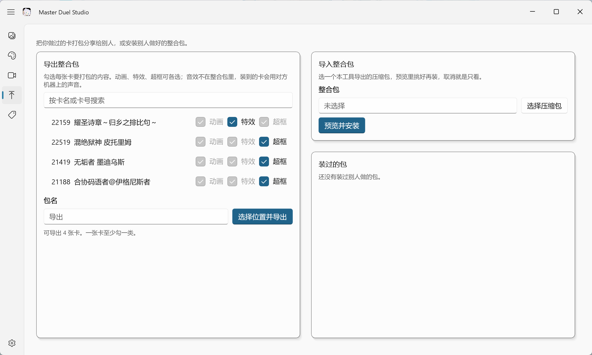<br><b>整合包</b></td>
    <td align="center">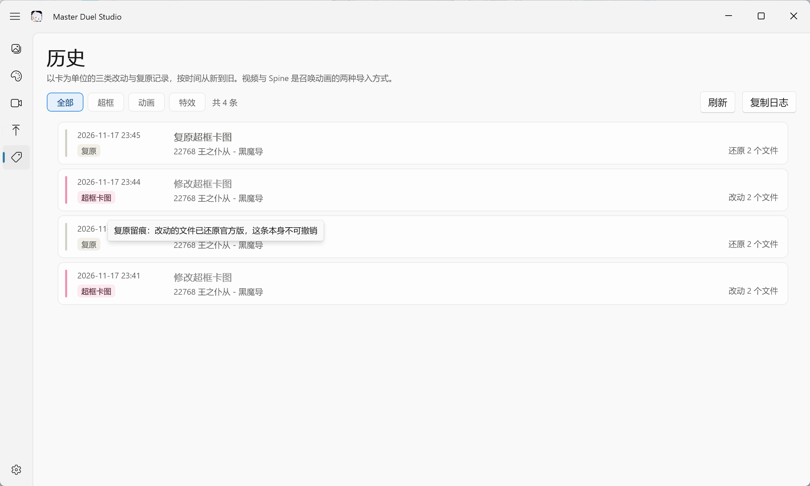<br><b>历史</b></td>
  </tr>
</table>

**超框效果**（主体跨出框线，箭头等外沿元素压在主体之上）：

<a href="docs/demo/overframe-demo.png">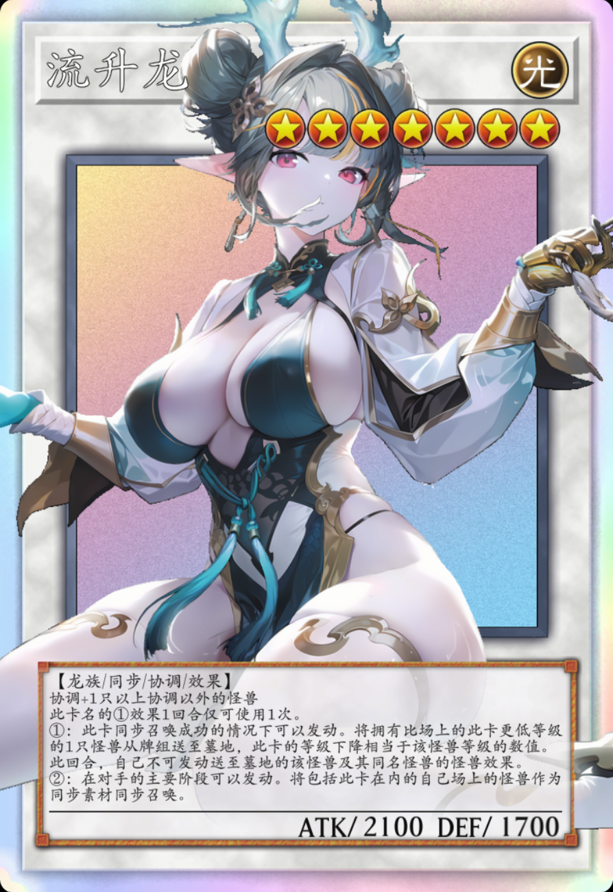</a>

**设置页**（游戏目录、账号、预演、可选组件按需下载）：

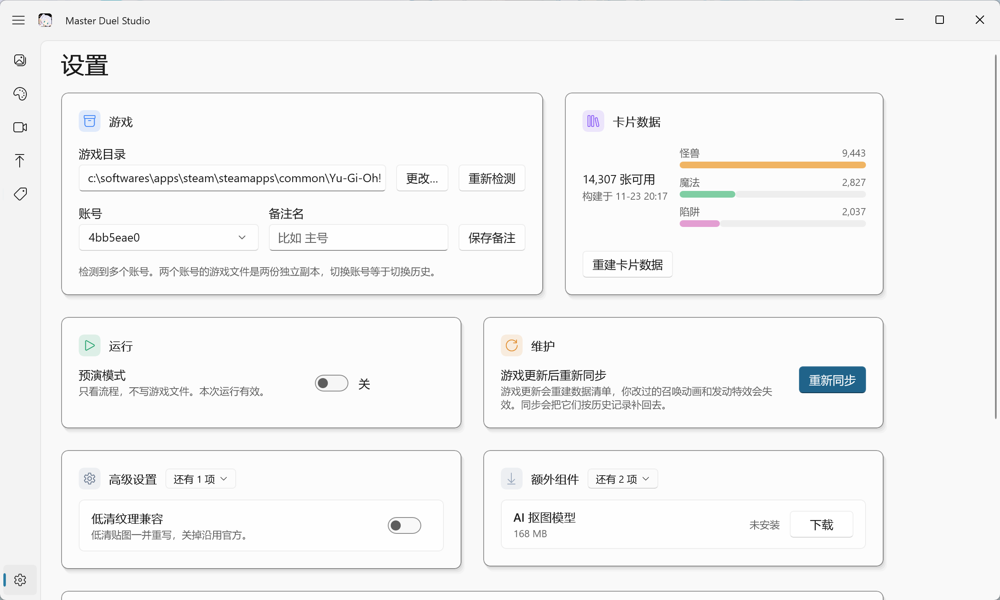

---

## 🎬 视频教程

<a href="https://www.bilibili.com/video/BV1tAx96cEdF/">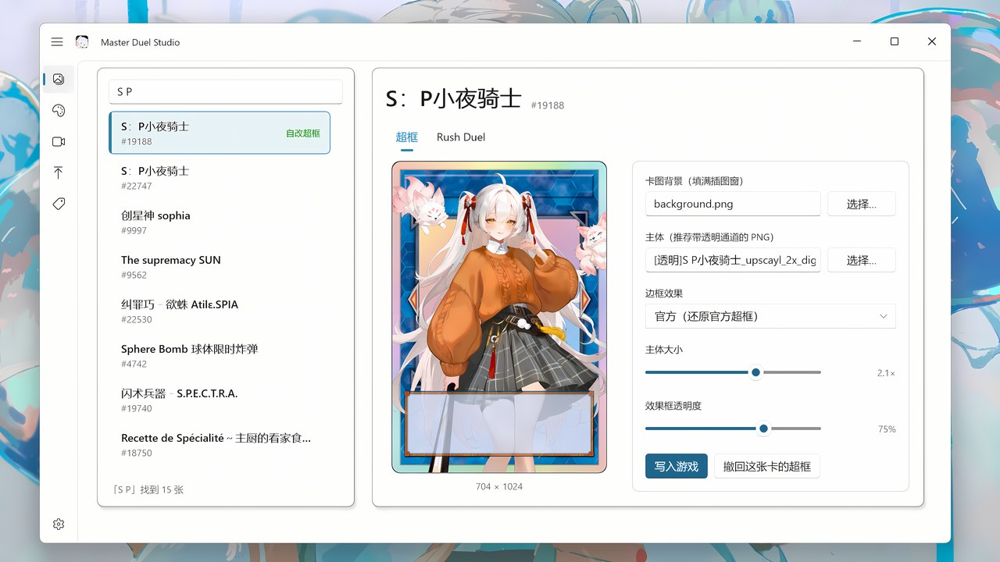</a>

手把手演示完整流程，点封面跳转 B 站。

**动图演示**

| 召唤动画 | 发动特效 |
|---|---|
| 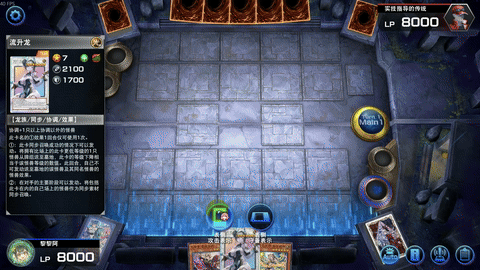 | 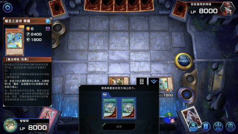 |

---

## 📖 页面详解

左侧导航五格：**超框卡图 / 大厅壁纸 / 召唤动画**（同一页里用「修改召唤动画」「修改卡牌特效」两个标签切换）**/ 分享 / 历史**，设置在最下面。

### 🖼 超框卡图

把一张卡的插图拆成「背景」和「主体」两层：背景填满插图窗，主体按比例放大后压在上面，于是角色会跨出卡框，形成超框效果。

**左侧列表**

- 搜索框支持卡名或卡号
- 顶部按状态筛选四档，互斥且完备：

| 档位 | 含义 |
|---|---|
| 官方超框 | 游戏自带，工具没动过 |
| 自改超框 | 工具写入的版本。原本官方有没有都算这一档，来历看行标签的悬停 |
| 无超框 | 本来就没有，也没改过 |
| 未上线 | 名字有了，游戏里还没放出来 |

- 行标签的悬停会交代来历：`来自官方超框`（原本官方有，被你的版本覆盖）或 `来自无超框`（原本没有，工具新加的）
- 占位卡（另一张卡的副本号，游戏实际按真卡号渲染）会灰掉，点不动

**右侧参数**

| 参数 | 说明 | 范围 / 默认 |
|---|---|---|
| 卡图背景 | 填满插图窗的底图 | 不选则沿用游戏当前卡图 |
| 主体 | 要跨出框线的角色图，建议带透明通道的 PNG | 不选就只换背景，没有出框效果 |
| 边框效果 | 棱彩（外沿按卡型换色）/ 虹彩（整圈艳彩虹）/ 幻彩（柔和淡彩环带）/ 官方（还原官方超框）/ 不改边框（保留原生卡框） | 默认「棱彩」 |
| 主体大小 | 主体相对铺满的放大倍数 | 0.5× ~ 3.0×，默认 1.0× |
| 效果框透明度 | 底部效果文本区的底板透明度，1.0 = 完全遮住主体 | 0.2 ~ 1.0，默认 1.0 |

- 预览里**直接拖动主体**可以微调位置，比填数字快
- 「生成超框」写入当前卡；「复原」把这张卡恢复原图并撤掉超框登记
- **同一张卡不能连续生成**：已经挂着工具写入的超框时（包括整合包装入的），必须先点「复原」才能再生成

### 🎞 召唤动画

左侧是卡列表，可按名称或编号搜索。右侧是当前卡的动画状态与生成参数。

**先看卡的状态**

| 状态 | 含义 | 生成时怎么处理 |
|---|---|---|
| 官方动画 | 游戏自带一套 | 视频导入把整套结构换成来源卡的；Spine 导入原地替换骨架与贴图 |
| 官方动画★ | 动画整份借自另一张卡，自己没有高清资源 | 克隆来源卡那一套 |
| 自改动画 | 已经是工具做的版本 | 先点「复原」才能再生成 |
| 无动画 | 游戏里没有这一套 | 克隆来源卡那一套 |

**来源卡**

- 官方动画、官方动画★、无动画三档都显示这一栏。自改动画已经生成过，来源卡不再参与，这一栏收起
- 视频导入**一律克隆**：来源卡的 prefab、相机、Timeline 分镜整套复制到目标卡名下，**来源卡本身一个字节都不动**。所以三种状态出来的画法一致，差别只在原本有没有东西要被覆盖
- Spine 导入换的是骨架与贴图，来源卡只用来取卡种模板
- 默认按召唤类型自动填：通常/效果 3880、融合 3435、仪式 15640、同调 8121、超量 12328、连接 13088
- 也可以手动换。不同召唤类型的演出结构不一样（相机位置、挂点、Timeline 上挂的雾效光效），用同类型的来源卡克隆，出来的观感更接近那种召唤方式本来的样子
- 这六张来源卡自己被锁住，不允许改动画：它们的结构一旦漂移，之后从它们克隆出来的卡会跟着继承问题

**两档内置方案**

方案下拉里只有两个内置档，选它就是一次性把这组参数填好。

| | 低（一页） | 高（两页） |
|---|---|---|
| 帧数 | 48 | 72 |
| 像素/帧 | 1800 | 2560 |
| 时长 | 1.6 秒 | 1.6 秒 |
| 角色高度 | 1.00（一屏） | 1.00（一屏） |
| 贴图 | 一页 7×7，约 158 MB | 两页 6×6，约 471 MB |
| 播放帧率 | 30 fps | 45 fps |
| 默认选中 | ✓ | |

- 低档的 1800 是按 2K（2560×1600）上角色弹出峰值约 1760px 反推的。再往下调，峰值那一瞬间会被放大，明显发虚
- 两档的弹出节奏完全一致，切换档位不会出现手感变化
- 自己改过参数后可以另存成新方案，也可以删掉；内置两个方案不占存储

**两种导入方式**

**① 视频类导入**（视频 / GIF / 帧文件夹）

| 参数 | 说明 | 范围 / 默认 |
|---|---|---|
| 帧数 | 总共切多少帧 | 4 ~ 300，默认随方案（低 48 / 高 72） |
| 时长（秒） | 动画在游戏里播多久 | 0.4 ~ 15，默认 1.6 |
| 像素/帧 | 单帧贴图的边长，决定清晰度上限 | 128 ~ 4096，默认随方案（低 1800 / 高 2560） |
| 角色高度 | 角色有多高，按屏幕高度的比例算，1.00 就是一屏 | 0.2 ~ 2.0，默认 1.00 |
| 左右移（% 屏宽） | 填 25 就是屏宽的四分之一，正数向右 | −75 ~ 75，默认 0 |
| 上下移（% 屏高） | 填 25 就是屏高的四分之一，正数向上 | −75 ~ 75，默认 0 |
| 旋转（度） | 整体旋转，正数逆时针 | −180 ~ 180，默认 0 |
| 放大倍数 | 额外缩放 | 0.2 ~ 4.0，默认 1.0 |
| 超分 | 先放大再用 Real-ESRGAN 修细节 | 关闭 / ×2 / ×4，默认关闭 |
| 弹出 | 出现时的缩放与淡入按帧走关键帧 | 默认 / 自定义 |
| 方案 | 把上面这组参数存成预设，下次一键套用 | 可保存、可删除 |

> 位移按屏幕比例算，跟分辨率、角色高度都无关，换个显示器不用重调。
>
> 素材怎么处理是自动判断的：自带透明通道就直接用；检测到纯色幕布（绿、蓝、品红、红）会自动去背；两样都没有就整段原样保留（全屏）。
>
> 「像素/帧」与「角色高度」要搭配着调：像素/帧大致等于角色在屏幕上的宽度时最划算，再高只是浪费体积。一页贴图装不下会自动分两页，两页还装不下会提示减帧数或减边长。

**弹出曲线（选「默认」时）**

| 时间 | 缩放 | 说明 |
|---|---|---|
| 0 秒 | 25% | 半透明淡入，第一帧就有存在感 |
| 0.14 秒 | 55% | 起势 |
| 0.35 秒 | 92% | 接近到位 |
| 0.54 秒 | 108% | 过冲，最「弹」的一下 |
| 0.73 秒 | 76% | 收回来，形成「duang」的收缩感 |
| 1.60 秒 | 90% | 停在九成大小，切回卡面时轻微弹大 |

- 曲线里的帧号只表示比例，**改总帧数不会改节奏**：48 帧和 72 帧都在 0.54 秒冲顶
- 想要别的节奏就选「自定义」，按 `(帧,缩放,透明度)` 连着写，帧号从左到右递增

**② Spine 导入**

支持 Spine 导出的文件夹、zip 或 bundle。3.x 的骨架会自动转成游戏用的 4.x，来源卡按卡种自动取模板，不用手选。

**预览**

生成完成后，卡列表那一行会多出一个播放按钮。它只出现在「自改」这一档：预览读的就是生成时留下的那份缓存。

- 播放器按生成时设定的时长与帧数播放，画布锁 16:9，缩放按当时那条弹出曲线走，观感与游戏里一致
- 播放 / 暂停（空格）、上一帧 / 下一帧、进度条拖动，速度可选 0.5× / 1× / 2×，循环可关
- 音效默认关，打开后按音效槽播写进去的那段声音
- 背景可以在场地线稿与纯黑之间切换，看透明边缘更清楚
- 浮层挂在主窗口上，切到别的页面也能直接叫出来，不用先回到动画页
- 动画与特效各存一套缓存，可以在设置页「预览缓存」里看占用、按卡删掉
- 复原时这份缓存会一起删除，之后想再看就得重新生成

**生成与复原**

- 同一张卡不能连续生成：已经挂着工具做的动画时，先点「复原」
- 「复原」把这张卡恢复成官方动画
- 生成时长改短也会把时间轴一起缩短，不会在游戏里留下静止的尾巴
- **低画质下也要播自己那套**：先在设置页打开「低清纹理兼容」。它只写一页贴图，参数超过一页会直接提示，不会写半套
- 关掉「低清纹理兼容」再生成时，低清那份会恢复成官方；克隆出来的卡本来就没有官方低清资源，那一份会保留上一次的内容

### 💥 卡牌特效

**两种做法**

**① 借用游戏里现成的特效**：整条效果搬过来，每次发动都会播。

**② 用视频自制**

| 参数 | 说明 | 范围 / 默认 |
|---|---|---|
| 帧数 | 切多少帧 | 4 ~ 300，默认 60 |
| 每帧高度（px） | 单帧贴图高度，只影响清晰度与体积，宽度按素材原比例 | 720 / 1080 / 1440，默认 1080 |
| 时长（秒） | 整段特效播多久 | 0.4 ~ 15，默认 2 |
| 画面高度 | 特效在屏幕上有多高，1.0 = 一屏，宽度按素材比例 | 0.1 ~ 1.5，默认 0.50 |
| 左右移（% 屏宽） | 填 25 就是屏宽的四分之一，正数向右 | −75 ~ 75，默认 0 |
| 上下移（% 屏高） | 填 25 就是屏高的四分之一，正数向上 | −75 ~ 75，默认 0 |
| 旋转（度） | 整体旋转，正数逆时针 | −180 ~ 180，默认 0 |
| 超分 | 先用超分把每帧放大再缩回，边缘更锐 | 关闭 / ×2 / ×4，默认关闭 |
| 用视频自带的声音 | 勾上就把视频音轨一起写进去 | 默认勾选 |

**特殊卡**

播的是融合召唤演出、没有独立发动特效的那批卡，工具不给生成区：融合、超融合、召唤魔术这类。它们也进不了整合包，导出时会跳过，安装别人的包时同样拦下。强写进去游戏也不会播，所以不如直接挡住。

**预览**

和动画一样，生成完列表那一行会出现播放按钮（只在「自改特效」这一档），点开按真实时长播一遍。特效与动画的预览缓存分开存，复原时一起删除。

**音效**（独立一块，常显）

- 「换一个音效文件…」用你自己的 WAV 替换
- 「改用别的音效槽」挑一个游戏里已有的槽
- ⚠️ 声音写进的是**整个音效槽**，用同一个槽的其他卡也会跟着变

> 这张卡要是官方自带发动特效，借用或自制都会覆盖它，随时可以点「复原」还原。同一张卡不能连续生成。

### 🌄 壁纸（大厅）

左右两栏各自独立，互不影响。

| 区域 | 替换对象 |
|---|---|
| 左 · 大厅壁纸 | `6aadf393` 里的 `WallPaper0001` |
| 右 · 大厅背景 | 6 个商店背景包，外加 `data.unity3d` 里的 `ShopBGBase02` 与 `TexSoloTransitionBG` |

**流程**：选图 → 「确认替换」→ 想撤销就点「还原」。

- 图片按等比缩放铺到目标尺寸，**不裁切**，两侧可能留透明边
- 右侧会列出 6 个包各一张代表图，加上 `data.unity3d` 的两张，共 8 格；选了自己的图会多出第 9 格
- 替换大厅背景要重写 100 多 MB 的 `data.unity3d`，比换壁纸慢，属正常
- 「还原」优先撤销历史记录；记录不在了也会用常驻的原图恢复

### 📦 分享（整合包）

把做过的卡打包给别人，或者装别人的包。**按卡号打包**：一张卡的动画、特效、超框可以分别勾选。

**导出**

| 参数 | 说明 |
|---|---|
| 卡列表 | 列出你改过的每张卡，三类内容各一个勾选框，可以只带其中一部分 |
| 包名 | 默认按「导出(内容+张数)_时间」自动生成 |
| 格式 | `ZIP 压缩包` 或 `文件夹` |

> 整合包**不含音效**。音效写的是整个音效槽，跨机器会互相干扰，所以不打包；装到的卡会用对方机器上现有的声音。

> 包里会带齐 manifest 依赖的整条闭包，对方没打开过那张卡、盘上没有对应资源也能装。文件已经不在盘上的记录（游戏校验或复原清掉了）与播融合演出的特殊卡会被跳过，不会让整包导出失败。

**安装**

| 参数 | 说明 |
|---|---|
| 选择压缩包 | 只接受本工具导出的整合包 |
| 预览并安装 | 打开预览，按卡列出包里的三类内容，勾好再装。**取消就是只看，不会写任何文件** |
| 本机已改过 | 那张卡这一类已经有你的版本时，预览里会提示先复原再装，避免两套版本叠在一起 |

> 包里的超框只带插图与素材，超框登记表在各账号现场生成，所以别人的包不会写错你的账号。

### 🕘 历史

按时间从新到旧，**以卡为单位**列出三类改动与每一次复原。这一页只做记录，不改游戏。

| 元素 | 说明 |
|---|---|
| 筛选 | 全部 / 超框 / 动画 / 特效 四档 |
| 行标签 | 召唤动画（附「视频」或「Spine」导入方式）、卡牌特效、超框卡图、复原 |
| 复原条目 | 灰色系。跟被撤销的类别一起出现在对应筛选里，同时保留被复原前那条改动 |
| 悬停 | 来源文件、改动了几个文件、这条是否还能复原 |

- 撤销入口不在这一页：超框、动画、特效各自在自己页面点「复原」
- 一次复原撤掉几类改动，被撤掉的那几条就各自回放一行，时间在原操作那一刻
- 音效不单独成行：它只是特效的配套改动，只算进那次复原的文件数里
- 复原会连同建在它上面的后续改动一起撤掉，同一张卡的链式操作请从后往前撤
- 导出整合包这类不改游戏的操作不进历史

### ⚙️ 设置

| 项目 | 说明 |
|---|---|
| 游戏目录 | 首次启动自动探测（Steam 注册表、库目录、常见安装位置），找不到才需要手动选 |
| 账号 | 同一台机器有多个账号时在这里切换；**每个账号的历史和改动分开存** |
| 备注名 | 给账号起个名字，显示在标题栏（`哈希 · 备注名`），比如「主号」 |
| 预演模式 | 只看流程和将要写入的文件，不落盘。本次运行有效，标题栏会挂一枚可点的徽章 |
| 低清纹理兼容 | 生成动画时把低清（SD）那份也一起重写，只写一页贴图。关掉后再生成会把低清那份恢复成官方；整合包里开与不开的卡混装时，只有开了的卡在低画质下生效。生成进行中不能改 |
| 重新同步 | 游戏更新后一键补回：召唤动画、发动特效、卡图登记、超框登记表 |
| 运行组件 | 三个可选组件在这里按需下载：AI 抠图模型、视频超分、Spine 转换器。装好前不影响其他功能 |
| 预览缓存 | 动画与特效的预览帧图占了多少、按卡清理。复原时对应那份会自动删掉 |
| 日志目录 | 出问题时可从这里取日志；历史页也能一键复制当前运行日志 |

---

## 🚨 使用须知

1. **写入前完全退出游戏**，写入后重新启动游戏才会生效
2. 精简包不含三个可选组件（AI 抠图模型 168MB、超分组件 43MB、Spine 转换器 11MB）。**软件照常能进**，用到哪个功能才提示下载，在设置页装；支持断点续传
3. 只支持 Steam 的 PC 版；游戏本体文件除大厅背景外不会被改动
4. 每张卡的改动都能单独复原：超框、动画、特效、壁纸各自在自己页面点「复原」
5. **同一张卡同一类不能连续生成**：先复原再生成，避免新旧两套文件叠在一起
6. **游戏更新会重建数据清单**，改过的动画和特效会失效。更新后到设置页点一次「重新同步」
7. 第一次用建议先开「预演模式」走一遍，确认流程和文件都符合预期
8. 整合包带版本号，**只认主版本**：主版本不同（比如包是 2、工具是 1）装不进去，提示升级工具；次版本之间互相通用
9. 整合包不含音效，装到的卡使用你机器上现有的声音

---

## ❓ 常见问题

**写入成功但游戏里没变化？**
两种常见原因：游戏没有完全退出；或者选错了账号（多账号时改动写在当前选中的那个账号上）。

**更新后改动全没了？**
正常。游戏更新会重建清单，到设置页点「重新同步」，它会按历史记录补回来。

**「复原」按钮是灰的？**
超框页的「复原」和壁纸页的「还原」都只在工具手上有记录时才亮。数据目录被清过，或者本来就没改过，它就是灰的。

**点「生成超框」被拦住了？**
这张卡上已经挂着工具写入的超框（包括整合包装入的）。先点「复原」，再生成新的。动画与特效页同理。

**装整合包时提示先复原？**
那张卡这一类已经有你的版本。先复原再装，否则两套文件会叠在一起，游戏里可能显示异常。

**换了大厅背景后想恢复原样？**
壁纸页右侧点「还原」。工具会留一份常驻原图，历史记录清了也能还原。

**为什么整合包里的卡没有音效？**
音效按整个音效槽写入，跨机器会互相覆盖，所以不打包。装到的卡沿用你本机现有的声音，需要的话在特效页单独换。

**高画质正常，切到低画质就变回官方动画？**
这张卡生成时没开「低清纹理兼容」（在设置页）。低清那份没被写过，游戏切低画质就用官方原版。要低画质也播自己的，打开开关重新生成一次。

**生成出来的角色太大或太小？**
用「角色高度」调，它按屏幕高度的比例算：1.00 就是一屏。改完不用重新切帧，重新生成即可。

**特效页有卡点不动，标着「特殊卡」？**
那几张播的是融合召唤演出（融合、超融合、召唤魔术这类），游戏里没有可替换的发动特效。硬写进去也不会播，所以工具直接锁住，导出与安装整合包时同样跳过。

**列表里的播放按钮不出现，或者点了说预览已删除？**
预览缓存只在生成成功后才有，复原时会被删掉；按钮也只出现在「自改」这一档。没有缓存就重新生成一次。占用多少在设置页「预览缓存」里看。

---

## 🔧 构建

需要 [Windows App SDK](https://learn.microsoft.com/windows/apps/windows-app-sdk/) 与 .NET SDK：

```bat
dotnet build src/MDStudio -c Release
```

打包便携版（解压即用，自动收集 Python 运行时与素材）：

```bat
python tools/build_portable.py
```

打包脚本不自带 Python 运行时：先准备一份装好依赖的完整 Python 3.13 放在 `../Env/python`
（或用环境变量 `MDSTUDIO_ENV` 指向别处），构建时会同步进便携包。

抠像模型 `tools/matting/isnet-anime.onnx` 体积过大不入库，构建前需要自备。

---

## 🙏 致谢

感谢以下开源项目：

- [MD-Card-Mod-Tool](https://github.com/noah-ad/MD-Card-Mod-Tool)
- [floowandereeze-and-modding-qt](https://github.com/Nauder/floowandereeze-and-modding-qt)
- [master-duel-modding](https://github.com/AmidoriA/master-duel-modding)
- [SpineSkeletonDataConverter](https://github.com/wang606/SpineSkeletonDataConverter)｜Spine 骨架跨版本升级
- [rembg](https://github.com/danielgatis/rembg)｜`isnet-anime` 抠图模型
- [Real-ESRGAN](https://github.com/xinntao/Real-ESRGAN)｜视频超分组件

以及感谢 DeepSeek 大肥鱼的背后默默付出！

## 🔗 推荐搭配

本软件搭配 [spineviewer-love](https://github.com/yihkllo/spineviewer-love) 与 [冷晴MD工具箱](https://www.bilibili.com/video/BV1yhpw6uE5B) 使用更佳！

## 📄 许可证

[MIT](LICENSE)
