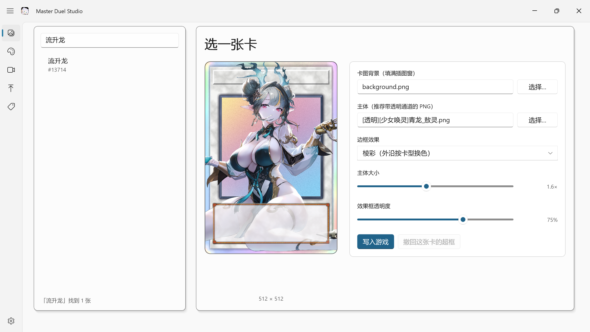
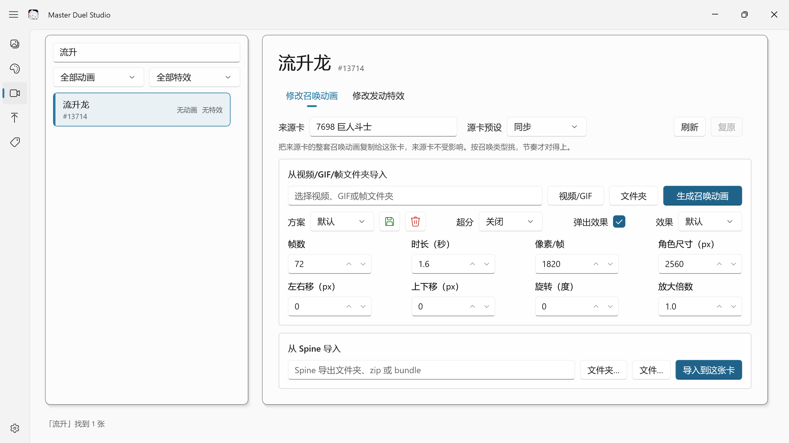
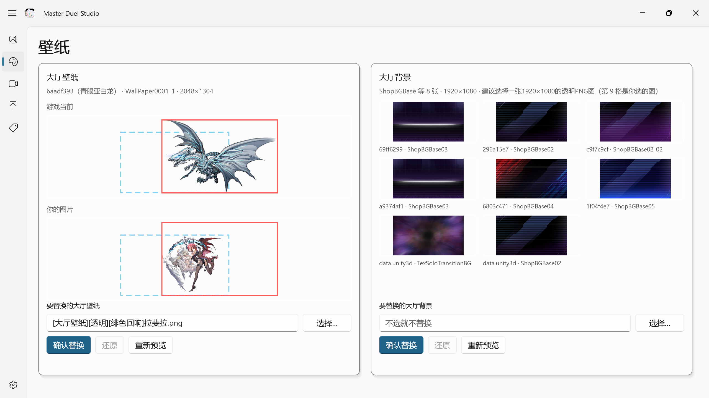
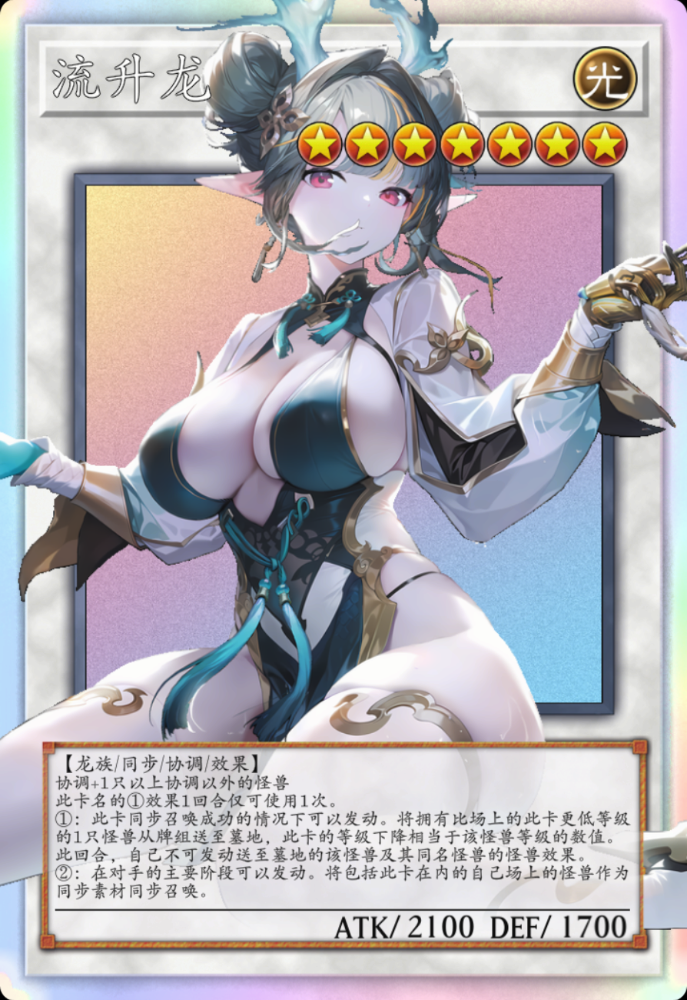
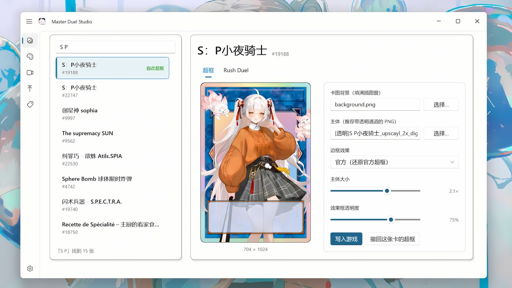
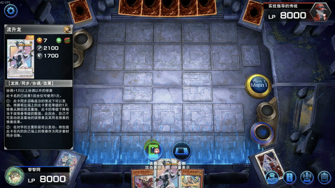
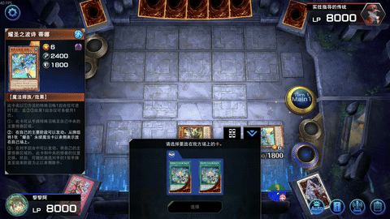

# 🎴 Master Duel Studio

《游戏王 Master Duel》的本地修改工具。召唤动画、发动特效、超框卡图、大厅壁纸，一个 WinUI 3 程序全部搞定，**每一次改动都能单独撤销**。

> 仅支持 PC 版（Steam），Windows 10 1809 及以上。
> 常规改动写入你自己的账号数据目录；替换大厅背景时会写入游戏的 `data.unity3d`，写入前会自动留一份原图。

---

## 📋 目录

- [功能一览](#-功能一览)
- [界面预览](#-界面预览)
- [视频教程](#-视频教程)
- [页面详解](#-页面详解)
- [使用须知](#-使用须知)
- [常见问题](#-常见问题)
- [构建](#-构建)
- [致谢](#-致谢)

---

## ✨ 功能一览

| 功能 | 做什么 | 写到哪里 |
|---|---|---|
| 🖼 **卡图** | 把卡面做成超框：主体跨出卡框，可换边框效果 | 账号目录 |
| 🎞 **动画** | 召唤动画：借用官方、视频自制、Spine 导入 | 账号目录 |
| 💥 **特效** | 发动特效：借用官方、视频自制，可换音效 | 账号目录 |
| 🌄 **壁纸** | 大厅壁纸与大厅背景替换 | 账号目录 + `data.unity3d` |
| 📦 **分享** | 把做过的卡打包给别人，或安装别人的包 | 按包内容决定 |
| 🕘 **历史** | 逐条撤销、游戏更新后一键补回 | — |
| 🧪 **预演** | 只走流程不写文件，本次运行有效 | — |

---

## 📸 界面预览

<table>
  <tr>
    <td align="center"><br><b>卡图</b> · 超框</td>
    <td align="center"><br><b>动画</b> · 召唤动画与发动特效</td>
    <td align="center"><br><b>壁纸</b> · 大厅</td>
  </tr>
</table>

**超框效果**（连接怪兽，主体跨出框线，点亮方向的箭头压在主体之上）：

<a href="docs/demo/overframe-demo.png"></a>

---

## 🎬 视频教程

<a href="https://www.bilibili.com/video/BV1tAx96cEdF/"></a>

手把手演示完整流程，点封面跳转 B 站。

**动图演示**

| 召唤动画 | 发动特效 |
|---|---|
|  |  |

---

## 📖 页面详解

左侧导航共五个页面：**卡图 / 壁纸 / 动画 / 分享 / 历史**，另有设置。

### 🖼 卡图（超框）

把一张卡的插图拆成「背景」和「主体」两层：背景填满插图窗，主体按比例放大后压在上面，于是角色会跨出卡框，形成超框效果。

**左侧列表**

- 搜索框支持卡名或卡号
- 每张卡带状态徽标：`官方超框`（游戏自带）、`自改超框`（本工具做过）、`占位卡`（这张卡是另一张的副本）、`未上线`

**右侧参数**

| 参数 | 说明 | 范围 / 默认 |
|---|---|---|
| 主体 | 要跨出框线的角色图，建议带透明通道的 PNG | 不选就只换背景，没有出框效果 |
| 卡图背景 | 填满插图窗的底图 | 不选则沿用游戏当前卡图 |
| 边框效果 | 棱彩（外沿按卡型换色）/ 虹彩（整圈艳彩虹）/ 幻彩（柔和淡彩环带）/ 官方（还原官方超框）/ 不改边框 | 默认「棱彩」 |
| 主体大小 | 主体相对铺满的放大倍数 | 0.5× ~ 3.0×，默认 1.0× |
| 效果框透明度 | 底部效果文本区的底板透明度，1.0 = 完全遮住主体 | 0.2 ~ 1.0，默认 1.0 |

- 预览里**直接拖动主体**可以微调位置，比填数字快
- 「写入游戏」写入当前卡；「撤回这张卡的超框」把这张卡恢复原图
- 边框效果与主体是可选的：只想要边框、不想要出框，把主体留空即可

### 🌄 壁纸（大厅）

左右两栏各自独立，互不影响。

| 区域 | 替换对象 |
|---|---|
| 左 · 大厅壁纸 | `6aadf393` 里的 `WallPaper0001` |
| 右 · 大厅背景 | 6 个商店背景包，外加 `data.unity3d` 里的 `ShopBGBase02` 与 `TexSoloTransitionBG` |

**流程**：选图 → 「确认替换」→ 想撤销就点「还原」。

- 图片按等比缩放铺到目标尺寸，**不裁切**，两侧可能留透明边
- 右侧会列出 6 个包各一张代表图，加上 `data.unity3d` 的两张，共 8 格；选了自己的图会多出第 9 格
- 替换大厅背景要重写 100 多 MB 的 `data.unity3d`，比换壁纸慢，属正常
- 「还原」优先撤销历史记录；记录不在了也会用常驻的原图恢复

### 🎞 动画（召唤动画 / 发动特效）

左侧是卡列表，可按名称或编号搜索，并用下拉框过滤：`全部动画 / 官方动画 / 自改动画`、`全部特效 / 官方特效 / 自改特效`。

右侧两个选项卡：**修改召唤动画** 与 **修改发动特效**。

#### 召唤动画 · 三种做法

**① 借用游戏里的动画**

- 填「来源卡」卡号，或从「源卡预设」按召唤类型挑一张（融合、同调、超量、连接等各有代表）
- 把来源卡的整套动画复制给这张卡，**来源卡本身不受影响**
- 想提前看效果，可以把来源卡填成目标卡自己

**② 用视频自制**

| 参数 | 说明 | 范围 / 默认 |
|---|---|---|
| 帧数 | 总共切多少帧 | 4 ~ 200，默认 120 |
| 时长（秒） | 动画在游戏里播多久 | 0.4 ~ 15，默认 4.8 |
| 像素/帧 | 单帧分辨率，也是清晰度上限 | 128 ~ 2048，默认 1080 |
| 角色尺寸（px） | 角色在屏幕上的宽度，决定观感大小 | 500 ~ 8000，默认 4800 |
| 左右移 / 上下移 | 位置微调，单位像素 | 任意，默认 0 |
| 旋转（度） | 整体旋转 | −180 ~ 180，默认 0 |
| 放大倍数 | 额外缩放 | 0.2 ~ 4.0，默认 1.1 |
| 超分 | 先放大再用 Real-ESRGAN 修细节 | 关闭 / 2× / 4×，默认关闭 |
| 弹出效果 | 出现时的缩放与淡入曲线 | 默认 / 自定义 |
| 方案 | 把上面这组参数存成预设，下次一键套用 | 可保存、可删除 |

> 「像素/帧」与「角色尺寸」要搭配着调：像素/帧大致等于角色在屏幕上的宽度时最划算，再高只是浪费体积。

**③ 从 Spine 导入**

支持 Spine 导出的文件夹、zip 或 bundle。3.x 的骨架会自动转成游戏用的 4.x。

**复原**：把这张卡恢复成官方动画。

#### 发动特效 · 两种做法

**① 借用游戏里的特效**：整条效果搬过来，每次发动都会播。

**② 用视频自制**

| 参数 | 说明 | 范围 / 默认 |
|---|---|---|
| 帧数 | 切多少帧 | 4 ~ 200，默认 60 |
| 每帧高度（px） | 单帧高度，宽度按 16:9 推算 | 128 ~ 2048，默认 1080 |
| 时长（秒） | 播放多久 | 0.4 ~ 15，默认 1.6 |
| 用视频自带的声音 | 勾上就把视频音轨一起写进去 | 默认勾选 |

**音效**（独立一块，常显）

- 「换一个音效文件…」用你自己的 WAV 替换
- 「改用别的音效槽」挑一个游戏里已有的槽
- ⚠️ 声音写进的是**整个音效槽**，用同一个槽的其他卡也会跟着变

> 这张卡要是官方自带发动特效，借用或自制都会覆盖它，随时可以点「复原」还原。

### 📦 分享（整合包）

把做过的卡打包给别人，或者装别人的包。**按卡号打包**：同一张卡的动画、特效、卡图会一起走。

**导出**

| 参数 | 说明 |
|---|---|
| 勾选列表 | 列出你改过的每张卡，右侧标注包含的类型（召唤动画 / 发动特效 / 卡图） |
| 包名 | 默认 `my-pack` |
| 格式 | `ZIP 压缩包` 或 `文件夹` |

**安装**

| 参数 | 说明 |
|---|---|
| 选择文件 / 选择文件夹 | 只接受本工具导出的整合包 |
| 查看 | 先看看包里有哪些卡、哪些类型，再决定装不装 |
| 跳过已安装的卡 | 默认勾选，装过的卡不重复写 |
| 覆盖已有 | 覆盖本工具之前做过的同卡改动 |

> 包里的卡图只带插图本体，超框登记表在各账号现场生成，所以别人的包不会写错你的账号。

### 🕘 历史

每条记录包含时间、操作类型、目标卡或整合包、来源。

- 「撤销选中的」撤掉当前这条；「撤销最近一条」直接撤最新一条
- 卡片类记录会显示：`修改超框卡图`、`借用召唤动画`、`视频发动特效`、`替换音效` 等
- 整合包记录会按类型统计，例如「2 / 3 张卡（卡图 2、召唤动画 1）」
- 鼠标悬停能看到改动了几个文件、导出包的完整路径
- ⚠️ **撤销会连带撤掉建在它上面的后续改动**，同一张卡的链式操作请从后往前撤
- 导出整合包这类不改游戏的操作只留记录，不可撤销

### ⚙️ 设置

| 项目 | 说明 |
|---|---|
| 游戏目录 | 首次启动自动探测（Steam 注册表、库目录、常见安装位置），找不到才需要手动选 |
| 账号 | 同一台机器有多个账号时在这里切换；**每个账号的历史和改动分开存** |
| 备注名 | 给账号起个名字，显示在标题栏，比如「主号」 |
| 预演模式 | 只看流程和将要写入的文件，不落盘。本次运行有效 |
| 重新同步 | 游戏更新后一键补回：召唤动画、发动特效、卡图登记、超框登记表 |
| 日志目录 | 出问题时可从这里取日志 |

---

## 🚨 使用须知

1. **写入前完全退出游戏**，写入后重新启动游戏才会生效
2. 只支持 Steam 的 PC 版；游戏本体文件除大厅背景外不会被改动
3. 所有改动都在历史页，可逐条撤销
4. **游戏更新会重建数据清单**，改过的动画和特效会失效。更新后到设置页点一次「重新同步」
5. 第一次用建议先开「预演模式」走一遍，确认流程和文件都符合预期
6. 整合包格式有版本号，旧版工具做的包新版可能不认

---

## ❓ 常见问题

**写入成功但游戏里没变化？**
游戏没完全退出。任务管理器里确认 `masterduel.exe` 已经结束，再启动。

**更新后改动全没了？**
正常。游戏更新会重建清单，到设置页点「重新同步」，它会按历史记录补回来。

**「还原」按钮是灰的？**
说明工具手上没有可还原的记录，可能是数据目录被清过，或本来就没改过。

**装整合包时一堆卡被跳过？**
默认跳过已安装的卡。确实要覆盖，勾上「覆盖已有」再装。

**换了大厅背景后想恢复原样？**
壁纸页右侧点「还原」。工具会留一份常驻原图，历史记录清了也能还原。

---

## 🔧 构建

需要 [Windows App SDK](https://learn.microsoft.com/windows/apps/windows-app-sdk/) 与 .NET SDK：

```bat
dotnet build src/MDStudio -c Release
```

打包便携版（解压即用，自动收集 Python 运行时与素材）：

```bat
python tools/build_portable.py
```

打包脚本不自带 Python 运行时：先准备一份装好依赖的完整 Python 3.13 放在 `../Env/python`
（或用环境变量 `MDSTUDIO_ENV` 指向别处），构建时会同步进便携包。

抠像模型 `tools/matting/isnet-anime.onnx` 体积过大不入库，构建前需要自备。

---

## 🙏 致谢

感谢以下开源项目：

- [MD-Card-Mod-Tool](https://github.com/noah-ad/MD-Card-Mod-Tool)
- [floowandereeze-and-modding-qt](https://github.com/Nauder/floowandereeze-and-modding-qt)
- [master-duel-modding](https://github.com/AmidoriA/master-duel-modding)

以及感谢 DeepSeek 大肥鱼的背后默默付出！

## 🔗 推荐搭配

本软件搭配 [spineviewer-love](https://github.com/yihkllo/spineviewer-love) 与 [冷晴MD工具箱](https://www.bilibili.com/video/BV1yhpw6uE5B) 使用更佳！

## 📄 许可证

[MIT](LICENSE)
